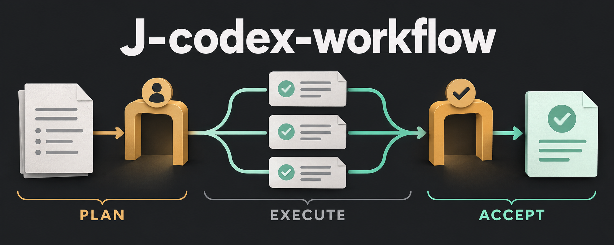

# J-codex-workflow

[English](README.md) · [简体中文](README.zh-CN.md)

**Confirm the plan. Follow native execution. Accept the result.**

A local Codex plugin that turns a conversation into a confirmed workflow, with native subagents and a live inline board.

<p align="center">
  
</p>

*ImageGen concept illustration of the workflow; not a product screenshot.*

[Quick start](#quick-start) · [How it works](#how-it-works) · [Native evidence](docs/NATIVE_ACCEPTANCE.md) · [Interface contract](docs/CONTRACT.md)

> **Early preview · v0.3.0**
>
> All 52 local tests pass. The v0.1.1 packaged plugin completed a user-confirmed workflow with one native subagent and main-agent acceptance in the Codex desktop host, with independent MCP Apps DOM reads and screenshots. [Read the evidence and its scope →](docs/NATIVE_ACCEPTANCE.md)
>
> The newer profiles, consultation policy, and completion statistics have not undergone native-host acceptance. Linux host integration is also unverified.

## How it works

1. **Draft** — Describe your goal. The main agent defines roles, phases, dependencies, and observable acceptance criteria.
2. **Confirm** — Review the current draft in conversation. Workflow subagents start only after you confirm that version.
3. **Execute** — Native Codex subagents do the work. The inline board updates automatically; side panel expansion is optional.
4. **Accept** — Returned work enters **awaiting acceptance**. The main agent checks the artifacts before marking tasks complete.
5. **Recover** — Failure or rejected review pauses new dispatch. In-flight work can return and is retained for acceptance; you decide whether to retry or cancel.

The board is read-only: you revise plans and control execution through conversation. A returned result is not automatically an accepted result.

## Quick start

**Requirements:** Python 3.9+, the Codex CLI, and a Codex desktop environment supporting local MCP plugins and native subagents. Development and local installation have been tested on macOS.

### 1. Build and install locally

```bash
git clone https://github.com/zj-linjie/J-codex-workflow.git
cd J-codex-workflow
python3 scripts/package.py
codex plugin marketplace add "$PWD/dist/marketplace"
codex plugin add codex-workflow@codex-workflow-local
```

Restart Codex, or open a conversation that has loaded the new tools. The display name is **J-codex-workflow**; the compatibility plugin ID remains `codex-workflow`.

The package embeds local launch paths: build on the machine where you use it, and rebuild after moving the project. Generated packages, databases, and credentials are excluded from Git.

### 2. Load native workflow profiles

Before using roles bound to the bundled profiles, inspect and run the installer:

```bash
python3 plugin/scripts/install_agents.py --dry-run
python3 plugin/scripts/install_agents.py
```

Restart or reload Codex and verify the intended types are available. The helper adds four `Workflow*` profiles alongside the originals; it preserves their configuration, leaves identical files unchanged, and refuses conflicts. To install at project scope, add `--destination /path/to/project/.codex/agents`. [Profile setup →](plugin/skills/codex-workflow/references/agent-profiles.md)

### 3. Request your first plan

In a conversation with the plugin loaded:

> Use J-codex-workflow to research this approach. Draft the roles, phases, and acceptance criteria, and wait for my confirmation before executing.

Review the board, request any changes, then confirm the current draft in conversation. During execution, you can ask to pause, retry a named failed task, or cancel. Ordinary pauses retain in-flight work; cancellation requires the main agent to interrupt active native subagents.

To revisit a run, ask the agent to use `workflow_list`, then `workflow_board` with that run's ID.

## Roles and completion statistics

| Native profile | Responsibility |
| --- | --- |
| `WorkflowExplorer` | Locate files and entry points |
| `WorkflowExecutor` | Implement a bounded task |
| `WorkflowReviewer` | Independently review stable work |
| `WorkflowExpertAdvisor` | Investigate complex decisions |

A native role binds its `agentType` to a loaded profile. The main agent passes the same type to `spawn_agent` and the running event. Legacy unbound plans remain readable. These new profiles still need live-host acceptance.

<details>
<summary><strong>Consultation after repeated setbacks</strong></summary>

The separate [orchestrator setting](plugin/settings/orchestrator.json) lets the main agent consider one Astra consultation after two setbacks on the same problem. It is enabled by default; set `enabled` to `false` to disable it. It does not switch the parent model or automatically retry a paused task. Live-host execution of this policy remains unverified. [Counters, quotas, and overrides →](plugin/skills/codex-workflow/references/escalation.md)

</details>

<details>
<summary><strong>What completion statistics measure</strong></summary>

After completion, the board collects one local snapshot of the **current main session and its subagents**, including activity before this workflow in the same chat. It shows input, cached input, output, and reasoning tokens; model/session breakdowns; and response-average output speed with sample counts and percentiles. Cached input and reasoning output are already included in their parent totals.

The main agent binds the actual `CODEX_THREAD_ID` as `sessionId` at creation. The board calls `workflow_usage` directly over MCP and reuses the saved snapshot; the model does not poll for statistics. Missing logs or an unbound legacy run produce partial/unavailable coverage. The current response may not yet be flushed to disk. Speed is not a streaming rate, and reports from runs in the same chat overlap. No billing estimates or raw conversation content are stored. Native-host acceptance of this feature is pending. [Scope and algorithm →](plugin/skills/codex-workflow/references/session-usage.md)

</details>

## Local by design

The plugin combines a reusable skill, a local stdio MCP server, an SQLite state store, and a self-contained HTML board. **No separate model API key or third-party Python packages are required.**

- **Explicit state:** each board binds to a run ID. Writes use revisions and idempotency keys.
- **Local records:** SQLite stores plans, summaries, artifact references, events, and numeric usage snapshots. Data defaults to `~/.local/share/codex-workflow/`; override it with `CODEX_WORKFLOW_DATA_DIR`.
- **Scoped statistics:** completion statistics read local session logs, without reading conversation databases or artifact contents.
- **Reported progress:** the main agent explicitly reports status. There is no independent subscription to all native agent lifecycle events or authentication of recorded agent IDs.
- **Recovery:** restarting the service restores saved records; the main agent reconciles actual native state before resuming.
- **Permissions:** confirming a plan does not grant extra filesystem, publishing, deployment, or messaging permissions.

## Development

```bash
python3 -m unittest discover -s tests -p 'test_*.py' -v
python3 scripts/dev_host.py
```

The second command starts a labeled development fixture for layout, automatic updates, and disconnect behavior. It is not Codex host validation. State tests use temporary SQLite databases or `CODEX_WORKFLOW_DATA_DIR`, avoiding the default user database.

| Path | Purpose |
| --- | --- |
| `plugin/skills/` | Planning, confirmation, dispatch, acceptance |
| `plugin/mcp/` | State store and MCP tools |
| `plugin/ui/board.html` | Inline workflow board |
| `examples/` | Research/review and implementation/review plans |
| `scripts/package.py` | Local marketplace and package build |

[Product specification](PRD.md) · [Interface contract](docs/CONTRACT.md) · [Local acceptance](docs/ACCEPTANCE.md) · [Native-host acceptance](docs/NATIVE_ACCEPTANCE.md)

## License

[MIT](LICENSE) © 2026 zj-linjie.
